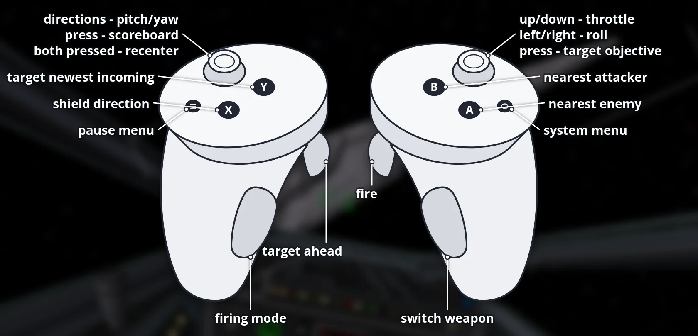

**X-Wing Revival VR 1.0.3**: [X-Wing Revival](https://github.com/Raptor007/X-Wing-Revival) 0.6.1 by Raptor007 running natively on Meta Quest and PICO (OpenXR + OpenGL ES through gl4es), plus a headless dedicated server for Linux.

**One APK:** `X-Wing-Revival-VR-v1.0.3-full.apk` (234 MB) has the X-Wing Revival 0.6.1 game data built in. Install it and play.

### Changes since v1.0.2
- **Fly Online** now joins the official Raptor007 server (`www.raptor007.com:7000`); the X-Wing Revival VR server is gone from the game

### Changes since v0.1.1-beta
- Menus, lobby and pause menu: the space background (or the paused battle) now surrounds you in 3D, with the menu floating in front of you
- On-screen keyboard in VR: opens when you click a text field (pilot name, server address), typed with the laser pointer
- **Upload Mission** button in the lobby to send your own custom missions to the server
- PICO support (PICO 4 / 4 Ultra / Neo 3), same APK
- Dedicated server: works on any x86_64 Linux (statically linked)

### What works
- Head-tracked stereo 3D in flight, from the cockpit, at 72 Hz
- Menus on a big screen that stays in place, with the space around you
- Touch controllers bound as a joystick in flight, remappable in *Controls*
- Laser pointer and on-screen keyboard for the menus
- **Fly Online** joins the official Raptor007 server (`www.raptor007.com:7000`); *Custom / LAN* lists it too
- Single player, LAN and online games; the Linux dedicated server works with Quest, PICO and PC players
- Custom missions (see below)

### Install
1. Install `X-Wing-Revival-VR-v1.0.3-full.apk` with SideQuest or `adb install -r X-Wing-Revival-VR-v1.0.3-full.apk`.
2. Start **X-Wing Revival VR** from *Unknown Sources* and allow "access to all files" when asked.
3. The first start unpacks the game data to `/sdcard/XWingRevival/` (about 310 MB, takes a moment), then the menu appears.

### PICO
The same APK runs on **PICO 4 / 4 Ultra / Neo 3** (untested on real PICO hardware). PICO needs **PICO OS 5.9.0 or newer**. Controller buttons are the same as on Quest. If it doesn't start on PICO, please open an issue with the output of `adb logcat -s XWingRevival`.

### Controls

| Input | Flight | Menus |
|---|---|---|
| Left stick | Pitch and yaw | |
| Right stick | Roll (left/right), throttle (up/down) | Scroll |
| Right trigger | Fire | Click |
| Left trigger | Target what's in front of you | |
| Right grip | Switch weapon (lasers / ions / torpedoes) | |
| Left grip | Firing mode (single / linked) | |
| A / B | Target nearest enemy / nearest attacker | B = back |
| X / Y | Shield direction / target newest incoming | |
| Right stick click | Target objective | |
| Left stick click | Scoreboard | |
| Left Menu button | Pause menu | Back |
| Hold both stick clicks 1 s | Recenter view | Recenter view |

### Custom missions
Missions are `.def` text files (the built-in campaign missions in `Missions/` show the format).
- **Playing alone / hosting from the headset:** copy the `.def` file to `/sdcard/XWingRevival/Missions/` (mission sounds to `Missions/Sounds/`), then pick it in the lobby: *Game Type → Mission*.
- **On a dedicated server:** put the `.def` file into the server's `Missions` folder and restart it; every player can pick it.
- **Upload from the game:** in the lobby click **Upload Mission**, choose a mission from your `Missions` folder and click *Upload*. Works while the server allows changes by everyone (`permissions` = all, the default).

### Dedicated server (Linux x86_64)
Unpack `X-Wing-Revival-VR-server-v1.0.3-linux-x86_64.tar.gz` and run `./start-server.sh`. It needs no graphics card or display; on the first start it downloads the official game once and keeps only the data the server needs. Players join on TCP port 7000 (on a LAN it shows up in *Custom / LAN*). PC players with the original game join an Internet server by typing its address in *Custom / LAN* → *Connect to IP Address*.

### Known limits
- Big fleet battles run at about 45-65 FPS (72 Hz display); the engine draws each eye separately.
- Graphics are set lighter than on PC (debris, lights, blast marks); raise them in *Preferences* if you like.
- The lobby chat line has no on-screen keyboard.

### Building
CMake for everything (`CMakeLists.txt`): `cmake -S . -B build` (Linux client), `-DXWR_SERVER_ONLY=ON` (dedicated server), and the VR app with `cd quest && ./gradlew assembleRelease`. Submodules: `git submodule update --init --recursive`.

Credits: X-Wing Revival and RaptorEngine by [Raptor007](https://github.com/Raptor007). VR port by SgtBilko76.
